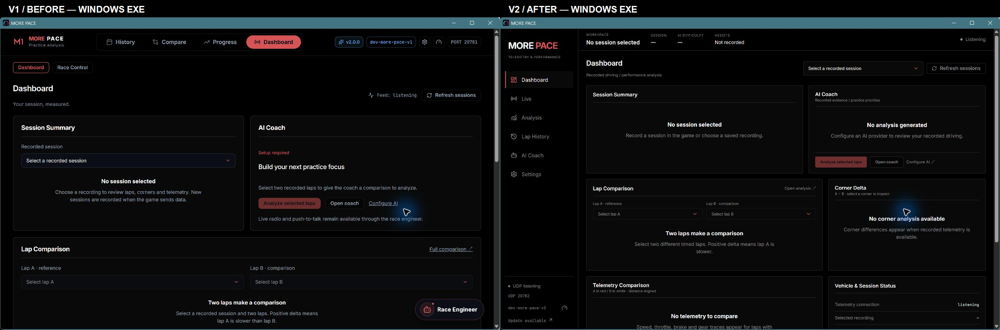

# MORE PACE — Dashboard structural redesign v2

MORE PACE now opens `/dashboard` on a normal app launch, including when an older browser profile remembers History or Live. Explicit deep links still work. The six sidebar destinations are Dashboard, Live, Analysis, Lap History, AI Coach and Settings. Track progress remains available from Analysis; it is not a Dashboard widget.

The desktop shell has a fixed 198 px sidebar and a 56 px session information bar. Dashboard uses three explicit row grids: Session Summary / AI Coach at 55:45, then Lap Comparison / Corner Delta and Telemetry Comparison / Vehicle & Session Status at 60:40. Below tablet width the panels stack. Cards use 4 px corners and restrained spacing, with no ambient effects or decorative hero heading.

## Recorded analysis

The newest saved session loads automatically; the selector can change or clear it. Session Summary uses the recorded player's timed laps when that car is known, otherwise explicitly labels all-car data. Best lap uses valid timed laps, and theoretical time sums the available best sectors from those valid laps. Missing values stay empty. Comparison selections retain driver, lap time, validity and missing-telemetry labels. Different laps are required.

Lap Comparison includes sector values, lap delta and a distance-aligned speed overlay. Corner Delta lists measured differences, with a button to zoom all traces to that corner. Telemetry Comparison reuses the existing speed/throttle/brake/gear strips in a compact local layout, without overwriting the full comparator's saved strip preferences. Open analysis retains the selected identifiers and zoom.

The existing Go REST APIs, telemetry websocket, session cache, corner analysis, AI streaming, voice/radio and storage services remain in use. AI requests carry only recording/lap identifiers; each response now retains its request context on the client so the Dashboard can show the actual response for the exact selected pair. Greetings, unrelated comparisons and errors are not presented as coaching results. Generation is always requested explicitly. The dedicated AI Coach page reuses the full existing conversation and settings UI.

The information bar uses the selected recording for circuit, session type and AI difficulty, while connection status is explicitly current. Assist settings are not exposed by the recorded-session API, so the bar says **Not recorded**. Live vehicle values appear only when actually received; the separate Live screen retains the complete vehicle, tyres, fuel, timing and voice modes.

## Compatibility and verification

The executable/archive name, database/storage paths, updater identifiers, Windows class, autostart entry and WebView profile remain unchanged. This is a development build; no release tag or installation over the current app is performed.

The new Windows executable was launched with an isolated database/port, opened Dashboard at startup, and navigated to the independent Live view and back. Existing recorded sessions were also checked through the browser; recordings without detailed samples correctly show telemetry Empty States. No AI response was manually generated because the connected provider was not configured.

Both screenshots below are unretouched captures of the actual Windows executables in equally sized windows (1269 × 795 captured pixels), with empty recordings. Only a comparison label and side-by-side placement have been added. Any pointer highlight belongs to the capture environment.

