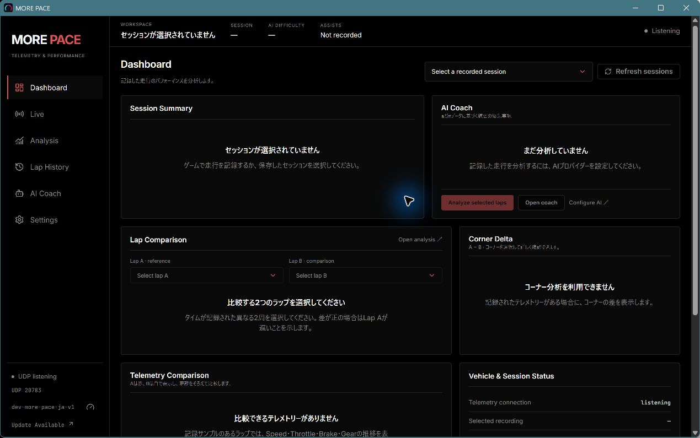
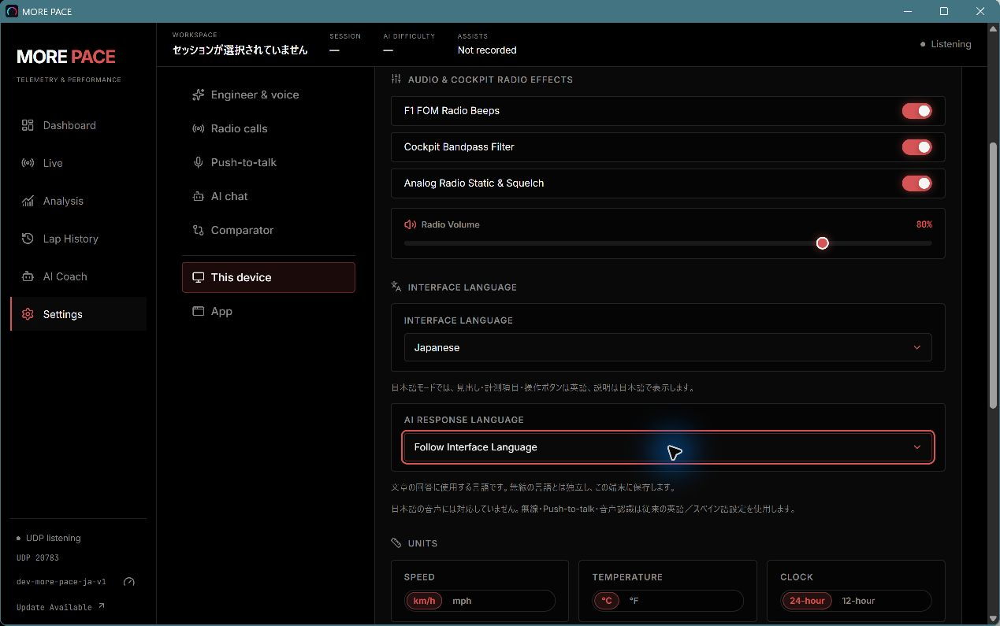

# MORE PACE — Japanese hybrid interface

## Use

Open **Settings → This device** and choose **Interface Language → Japanese**. Navigation, panel titles, metrics, chart axes and controls stay English; explanations, help, confirmations, empty states and errors use Japanese. English and Spanish remain available. With no saved choice, a Japanese browser starts in Japanese; existing saved English/Spanish choices are respected.

**AI Response Language** is a separate text setting: Japanese, English or **Follow Interface Language** (default). Follow also supports existing Spanish interfaces. Changing it does not change the provider, models, keys, custom persona instructions or conversation. Existing messages and practice notes are not translated or rewritten. New text requests use the selected response language even when the question is in another language.

Interface language uses the existing `f1_telemetry_language` browser setting. Text language uses `f1_ai_response_language`, alongside the existing device preferences. Both follow the existing cross-window storage synchronization. They are per browser/device, not shared server settings. No database migration, key migration or reset is performed.

## Text and voice

Text requests retain their existing context, provider and model payload. The final system-prompt directive applies to comparator, recorded-session debrief, live and general modes. Japanese replies are instructed to distinguish measurements from inference, avoid invented numbers, state uncertainty and prioritize concrete practice actions. This instruction guides the model; it is not a guarantee about every external provider's output.

Japanese speech is **not implemented** in this version. The current radio catalog, speech recognition (`en-GB` / `es-AR`), TTS voice mappings, push-to-talk and proactive calls remain English/Spanish. Radio Automatic with a Japanese interface resolves to English; an explicit Spanish radio choice stays Spanish. The response-language preference is never used by the speech path. Settings displays this limitation in each language. Native tray/window structural labels remain English.

## Translation maintenance

Reuses the lazy-loaded `frontend/src/locales` dictionaries and `useI18n`. No new dependency. `ja/translations.json` contains Japanese prose and a few explicitly English language-setting labels. Other English labels are explicitly reviewed in `ja/retainedEnglish.json` (test-only manifest). The runtime hybrid dictionary derives those structural labels from English, preserving the existing English fallback.

`locales/japanese.test.ts` checks every English key is classified exactly once, flags added keys/changed retained labels, and checks interpolation variables. A new or edited English key needs either a translation or an intentional-English manifest review. Do not regenerate the manifest blindly. Technical diagnostic details returned by APIs/providers can retain their original text after a Japanese message; release-note content received from GitHub retains its author's language.

Japanese uses Windows system font fallbacks (Yu Gothic UI / Meiryo) while numerical text keeps JetBrains Mono. No theme or grid changes. Japanese dates use `ja-JP` with the existing timezone/clock and unit preferences; stored timestamps and telemetry values are unchanged.

## Scope and review

Covers Dashboard, workspace navigation, AI Coach, Settings, Lap History, Analysis, progress, Live/Race Control, Driver warnings, Voice Cockpit guidance and update/error UI through the existing dictionaries. The Dashboard strings are now keyed and include Spanish translations.

Development branch: `feat/japanese-hybrid-localization`, based on the unmerged Dashboard v2 branch. The PR targets that branch so localization is independently reviewable; merge Dashboard v2 first and retarget as needed. No official release, updater change, executable rename, installation, storage-path change or app-identity change.

Actual Windows screenshots (isolated empty review database; no fabricated analysis):

The pointer highlight in captures belongs to the desktop capture environment.

## Validation (Windows, 2026-11-08 JST)

- React: 158 files passed; 1,241 tests passed, 1 existing skip. Final complete run used the frozen final dictionaries. Includes locale switching/persistence, independent AI request language, preserved Spanish radio setting, key classification, placeholders and Japanese date/radio resolution.
- Go: `go test -race -count=1 ./...`: 17 packages passed, 1,767 test/subtest passes, 5 skips. Includes Japanese/English/Spanish response directives in all four chat modes.
- Frontend oxlint and production build: passed. Go vet, golangci-lint (0 issues), gofmt and generated wire-type checks: passed on Windows.
- Production Windows GUI exe built with the existing resources/build flow, retaining `f1telemetry.exe`. Development version: `dev-more-pace-ja-v1`.
- Launched with a dedicated database on HTTP 18083 / UDP 20783; reviewed Japanese Dashboard and AI Coach, switched Japanese → English → Spanish → Japanese, independently selected Japanese AI text with Spanish UI, then restored Follow Interface Language. Restarted the app and verified both stored choices. Reviewed Race Control's waiting guidance and Voice Cockpit's engineer-window explanation. Captured screenshots with actual Windows windows. The review instance was stopped afterward.
- Automated tests cover Driver warnings and update strings; manual review did not exercise real driving/received telemetry, actual microphone/TTS, external AI generation, a real update installation or every populated dialog. Those require the game, speech service, provider credentials or release environment. External AI correctness is not guaranteed by language prompting.
- Test-run output includes existing React `act` and jsdom canvas/media warnings; there are no failing tests or lint warnings in the final run.
